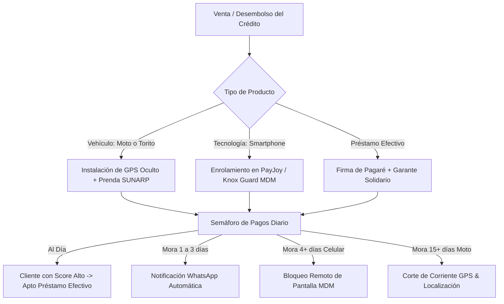

# DOCUMENTO MAESTRO DE CONTEXTO & ESPECIFICACIÓN TÉCNICA (V2.0)
## Proyecto: Inversiones JP (Ecosistema Retail Financiero & Dashboard Administrativo)
**Para ser utilizado como contexto integral para Claude y el equipo de desarrollo de software**

---

> **Versión**: 2.0 (Ampliación: Plataforma Web Pública + Dashboard Administrativo de Créditos, Inventario y Cobranzas)  
> **Empresa**: Inversiones JP (Evolución de JP Motors / Inversiones Multimarca JP)  
> **Mercado Objetivo**: Perú (Urbano, Periurbano y Provincias)  
> **Objetivo del Documento**: Servir como especificación técnica, de producto, arquitectura de base de datos y modelo de negocio para codificar desde cero el sistema unificado (Frontend Público + Backend/Dashboard Administrativo).

---

## ÍNDICE GENERAL
1. [Visión General del Negocio & Ecosistema Inversiones JP](#1-visión-general-del-negocio--ecosistema-inversiones-jp)
2. [Auditoría Técnica del Código Base Actual (`JP-MOTORS`)](#2-auditoría-técnica-del-código-base-actual-jp-motors)
3. [Estrategia de Expansión & Benchmark de Competidores](#3-estrategia-de-expansión--benchmark-de-competidores)
4. [Catálogo de Productos Multicategoría (Público)](#4-catálogo-de-productos-multicategoría-público)
5. [Arquitectura Web Pública, Rutas & Simuladores de Crédito](#5-arquitectura-web-pública-rutas--simuladores-de-crédito)
6. [Módulo de Dashboard Administrativo (Backoffice / CRM / ERP)](#6-módulo-de-dashboard-administrativo-backoffice--crm--erp)
7. [Modelo de Datos & Esquema de Base de Datos (PostgreSQL / Prisma)](#7-modelo-de-datos--esquema-de-base-de-datos-postgresql--prisma)
8. [Generación de Contratos, Pagarés & Cronogramas Imprimibles](#8-generación-de-contratos-pagarés--cronogramas-imprimibles)
9. [Gestión de Riesgo, Cobranza & Tecnologías de Bloqueo](#9-gestión-de-riesgo-cobranza--tecnologías-de-bloqueo)
10. [Instrucciones Directas & Prompt Maestro para Claude](#10-instrucciones-directas--prompt-maestro-para-claude)

---

## 1. Visión General del Negocio & Ecosistema Inversiones JP

**Inversiones JP** se transforma de una concesionaria tradicional de motos a una **empresa de Retail Financiero / Fintech de Crédito al Consumo y Vehicular**. 

El ecosistema digital debe constar de dos grandes entornos perfectamente sincronizados:
1. **La Plataforma Web Pública (E-Commerce y Captación de Clientes)**:
   - Vitrina de **Motos lineales Honda**, **Mototaxis/Trimóviles Torito Bajaj** y **Honda Motokar**, **Celulares de todas las marcas** a crédito y repuestos.
   - Simuladores dinámicos de cuotas (mensuales para vehículos, semanales/quincenales para tecnología).
   - Formulario de evaluación crediticia online con derivación directa a WhatsApp Business.
2. **El Panel de Administración (Dashboard / Backoffice / CRM de Cobranzas)**:
   - Registro y control exhaustivo de clientes con perfil crediticio (KYC peruano: DNI, garante, recibos).
   - Control de inventario y activos vendidos con trazabilidad única: **N° de Motor, Chasis/VIN y GPS** para motos/toritos; **IMEI 1, IMEI 2 y licencia de bloqueo MDM/PayJoy** para celulares.
   - Motor de créditos para ventas a plazos (diario, semanal, quincenal, mensual) con configuración manual o automática de tasa de interés.
   - Módulo exclusivo de **Préstamos de Dinero en Efectivo** (mutuo dinerario) reservado para clientes fidelizados de la empresa.
   - Generación automática de contratos legales en PDF (con reserva de propiedad o pagaré) y cronogramas de pago.
   - Semáforo de cobranzas diario ("A quién le toca pagar hoy", "Clientes al día", "Clientes en mora") con recordatorios directos por WhatsApp.
   - Métricas y reportes financieros (cartera vigente, total cobrado, mora, utilidades por interés).

---

## 2. Auditoría Técnica del Código Base Actual (`JP-MOTORS`)

### 2.1 Stack Actual del Repositorio
- **Framework**: Next.js 16.2.4 (App Router)
- **Librería UI**: React 19.2.4 & React-DOM 19.2.4
- **Lenguaje**: TypeScript 5
- **Estilos**: Variables CSS en `src/app/globals.css` + maquetación intensiva con estilos inline (`style={{...}}`)
- **Tipografía**: Google Font `Outfit` (`next/font/google`)
- **Analítica**: Google Tag Manager / GA4 (`G-C6RTDH3SXY`)
- **Contacto**: `formsubmit.co/ajax/contacto@jpmotorshonda.com` y WhatsApp `+51 902 423 015`

### 2.2 Archivos e Imágenes Disponibles en el Repositorio
- **Logos**: `corporate_logo.png`, `premium_logo.png`, `logo.png`
- **Marcas en `/public/brands`**: `HONDA.png`, `KTM.png`, `LIFAN.png`, `RONCO.png`, `SUZUKI.png`, `YAMAHA.png`
- **Motos en `/public/motos`**: `cb125f.png`, `cb190r.png`, `dio.png`, `glh150.png`, `navi.png`, `nl125.png`, `nl150.png`, `wave.png`, `xr150l.png`, `xr190l.png`, `xre300.png`
- **Galería lifestyle en `/public/motos/gallery`**: `gallery-1.png` a `gallery-4.png`
- **Repuestos en `/public/repuestos`**: 17 imágenes (aceites sintéticos y minerales, llantas offroad y pista, filtros, cascos, cadenas, bujías, zapatas, disco)

### 2.3 Hallazgos y Errores a Superar en la Nueva Versión
1. **Filtro Roto en Portada**: `page.tsx` filtraba por `[1, 6, 11]`, pero `mockMotos.ts` solo tenía 4 modelos. Debe ser dinámico o por flag `destacado: true`.
2. **Inconsistencia de Categorías**: Categorías en `/motos` en singular/plural provocaban resultados en cero.
3. **Ausencia de Base de Datos Real**: La versión actual es puramente frontend estático. La nueva versión requiere backend con persistencia (PostgreSQL / Supabase / Prisma).
4. **Falta de Modularización**: Pasar de estilos inline masivos a componentes estilizados limpios con CSS Modules o Tailwind CSS.

---

## 3. Estrategia de Expansión & Benchmark de Competidores

### 3.1 Benchmark en el Mercado Peruano
- **Galgo Perú**: Crédito vehicular digital para independientes/extranjeros. *Debilidad*: No ofrece tecnología ni préstamos de efectivo; comisiones altas y trámite impersonal.
- **Crosland / Red Bajaj**: Dueño de Torito Bajaj en Perú. *Debilidad*: Financian con bancos y cajas tradicionales que exigen boletas de pago formales y rechazan al transportista informal.
- **Grupo EFE / Financiera Efectiva**: Líder retail en cuotas semanales. *Debilidad*: Precios de lista inflados al crédito, tiendas saturadas y procesos burocráticos.
- **Fintechs de Celulares (PayJoy / Balto)**: Crédito a smartphones con bloqueo de pantalla por impago. *Debilidad*: No ofrecen vehículos ni capital de trabajo.

### 3.2 Propuesta Única de Venta (UVP)
**"La Financiera del Emprendedor Peruano"**: Un ecosistema unificado donde el transportista y trabajador independiente obtiene su vehículo de trabajo (**Torito Bajaj o Moto Honda**), su herramienta de comunicación (**Smartphone en cuotas**) y, si es cliente cumplido, accede a **microcréditos de capital de trabajo en efectivo**.

---

## 4. Catálogo de Productos Multicategoría (Público)

### 4.1 Mototaxis & Trimóviles (Trabajo Urbano y Provincias)
1. **Torito Bajaj RE 4T (Pasajeros)**: Motor 198.6cc, 4 tiempos, encendido digital twin spark, versiones a Gasolina, Dual GLP y Dual GNV.
2. **Torito Bajaj Máxima Cargo**: Trimóvil de carga con tolva o furgón cerrado para reparto comercial.
3. **Honda Motokar NL150 / NL125**: El clásico motokar con carreta, líder indiscutible en la selva y provincias.

### 4.2 Motos Lineales Honda
- **Línea Trabajo**: Honda Wave 110S, GLH150, CB125F Twister, Navi 110.
- **Línea Todo Terreno / Doble Propósito**: Honda XR150L, XR190L, XRE300.
- **Línea Deportiva**: Honda CB190R.

### 4.3 Celulares a Crédito (Todas las Marcas)
- **Gama Trabajo & Batería Pesada (S/ 500 - S/ 1,100)**: Xiaomi Redmi 13C / Note 13, Motorola Moto G24/G54, Honor X6b.
- **Gama Media-Alta (S/ 1,200 - S/ 2,400)**: Samsung Galaxy A35/A55 5G, Xiaomi Poco X6 Pro.
- **Gama Premium (S/ 2,500+)**: Apple iPhone (13, 14, 15, 16) y Samsung Galaxy S Series.

### 4.4 Repuestos y Accesorios
- Lubricantes originales Honda, cascos normados, neumáticos, filtros, kit de arrastre y frenos.

---

## 5. Arquitectura Web Pública, Rutas & Simuladores de Crédito

### 5.1 Enrutamiento Público
```
/                           -> Home: Selector interactivo multi-vertical (Motos, Toritos, Celulares)
/vehiculos                  -> Catálogo vehicular (Filtros: Lineales, Trimóviles, Honda, Bajaj)
/vehiculos/torito-bajaj     -> Landing especializada en Torito Bajaj (Pasajeros, Carga y Gas)
/vehiculos/[id]             -> Ficha técnica + Simulador de crédito mensual (12-36 meses)
/celulares                  -> Catálogo de smartphones (Filtros: Marca, Cuota Semanal, Gama)
/celulares/[id]             -> Ficha de celular + Simulador semanal/quincenal
/repuestos                  -> Catálogo de repuestos con botón de pedido WhatsApp
/financiamiento             -> Solicitud de crédito con DNI y pre-evaluación
/nosotros                   -> Historia, tiendas físicas y libro de reclamaciones
```

### 5.2 Fórmulas de los Simuladores
- **Crédito Vehicular (Mensual a 12, 18, 24, 36 meses)**:
  Tasa referencial $i = 2.0\%$ mensual.
  $$\text{Cuota} = (P - \text{Inicial}) \times \frac{i \times (1 + i)^n}{(1 + i)^n - 1}$$
- **Crédito Smartphone (Semanal a 26, 39, 52 semanas / Quincenal a 12, 18, 24 quincenas)**:
  Tasa referencial $i_{sem} \approx 1.2\%$ semanal. Inicial flexible desde S/ 0 a S/ 80.

---

## 6. Módulo de Dashboard Administrativo (Backoffice / CRM / ERP)

El panel administrativo es privado (requiere autenticación con roles: `SUPERADMIN`, `ADMIN_CREDITOS`, `ASESOR_VENTAS`, `COBRADOR`).

### 6.1 Módulos del Panel Administrativo

```
/admin/login               -> Inicio de sesión seguro
/admin/dashboard           -> KPIs generales: Cartera colocada, cobros de hoy, mora, ventas del mes
/admin/clientes            -> Listado y registro detallado de clientes (KYC)
/admin/clientes/[id]       -> Ficha 360° del cliente: datos, garante, historial de créditos y pagos
/admin/inventario/motos    -> Control de motos/toritos (Stock, N° Motor, VIN, Placa, GPS)
/admin/inventario/celulares-> Control de celulares (Stock, IMEI 1/2, Serial, Estado Knox/MDM)
/admin/creditos            -> Registro y administración de créditos (Vehículos, Celulares)
/admin/prestamos-efectivo  -> Registro exclusivo de préstamos en efectivo para clientes recurrentes
/admin/cobranzas/hoy       -> Semáforo de cobranzas diario (A quién le toca pagar hoy, vencidos, pagados)
/admin/contratos           -> Generador e historial de contratos PDF y cronogramas
/admin/reportes            -> Reportes financieros: Ingresos por intereses, mora por tramos, flujo de caja
```

### 6.2 Datos Indispensables para Registro Completo

#### A. Datos del Cliente (KYC Peruano Robusto)
- **Identificación**: Nombres completos, Apellidos completos, Tipo Documento (`DNI`, `CARNET_EXTRANJERIA`, `PASAPORTE`), Número de Documento, Fecha de Nacimiento, Sexo, Estado Civil (`Soltero`, `Casado`, `Conviviente`, `Divorciado`).
- **Contacto Principal**: Teléfono celular (con WhatsApp activo), Teléfono fijo o celular secundario, Correo electrónico.
- **Domicilio**: Dirección exacta (Calle, N°, Mz, Lt, Int), Urbanización/Sector, Distrito, Provincia, Departamento, Referencia precisa de llegada, Tipo de vivienda (`Propia`, `Alquilada`, `Familiar`), Coordenadas GPS (latitud/longitud) para cobrador de campo.
- **Documentación de Respaldo**: Foto del DNI (ambos lados), Foto o PDF de Recibo de Luz o Agua (antigüedad < 2 meses), Foto de fachada del domicilio o negocio.
- **Datos Laborales / Negocio**: Ocupación o giro del negocio (`Mototaxista`, `Delivery`, `Comerciante`, `Empleado Dependiente`, `Independiente`), Dirección del trabajo/paradero habitual, Ingreso promedio mensual estimado.
- **Garante / Aval / Fiador (Indispensable para créditos vehiculares y celulares gama alta)**:
  - Nombres y Apellidos del Garante, DNI, Teléfono celular, Dirección, Parentesco (`Cónyuge`, `Familiar`, `Amigo`, `Compañero de Paradero`), Foto de DNI del garante.
- **Perfil Crediticio Interno**:
  - `Estado_Cliente`: `NUEVO`, `ACTIVO_AL_DIA`, `ACTIVO_EN_MORA`, `EXCELENTE_PAGADOR`, `BLOQUEADO_LEGAL`.
  - `Score_Interno`: Calificación de 1 a 5 estrellas generada automáticamente según su historial de pagos previos.
  - `Apto_Prestamo_Efectivo`: Booleano (`true`/`false`), que se activa automáticamente solo tras pagar con puntualidad su primer crédito de moto o celular.

#### B. Datos de Motos y Trimóviles Vendidos
- Tipo de Vehículo: `MOTO_LINEAL`, `TRIMOVIL_PASAJEROS` (Torito/Motokar), `TRIMOVIL_CARGA`.
- Marca (`Honda`, `Bajaj Torito`, etc.), Modelo, Año de Fabricación, Cilindrada (`cc`), Color.
- **Identificadores Únicos**:
  - **Número de Motor** (número grabado en el monobloque).
  - **Número de Chasis / Serie / VIN** (17 dígitos alfanuméricos).
  - **Número de Placa** (o estado "En trámite notarial/SUNARP").
  - **Número de Tarjeta de Propiedad** (TIVE SUNARP).
- **Control de Seguridad y Recuperación**:
  - Proveedor del GPS instalado (ej. Tracksolid, Concox, GPS Perú).
  - ID del Dispositivo GPS / IMEI del GPS.
  - Número de SIM card del GPS.
  - Estado del corta-corriente remoto (`Habilitado`, `Bloqueado/Apagado por Mora`).

#### C. Datos de Celulares Vendidos
- Marca (`Samsung`, `Xiaomi`, `Apple`, `Motorola`, `Honor`, `Infinix`), Modelo comercial exacto, Capacidad de Almacenamiento (ROM) y Memoria RAM (ej. 256GB / 8GB), Color.
- **Identificadores Únicos**:
  - **IMEI 1** (15 dígitos).
  - **IMEI 2** (15 dígitos, si es Dual SIM).
  - **Número de Serie de Fábrica (S/N)**.
- **Control de Bloqueo por Impago**:
  - Plataforma de Bloqueo vinculada (`PayJoy`, `Samsung Knox Guard`, `Trustonic`, `MDM Custom`).
  - ID de Dispositivo / Clave de enrolamiento en la plataforma de bloqueo.
  - Estado del Bloqueo: `DESBLOQUEADO_OPERATIVO`, `BLOQUEADO_POR_MORA`, `LIBERADO_DEFINITIVO` (tras culminar el crédito).

#### D. Datos de Registro de Créditos y Préstamos
- **Tipo de Operación**:
  - `CREDITO_VEHICULAR` (Venta de moto o Torito a plazos).
  - `CREDITO_CELULAR` (Venta de smartphone a plazos).
  - `PRESTAMO_EFECTIVO` (Mutuo dinerario exclusivo a clientes recurrentes con historial A1).
- **Valores Financieros**:
  - Monto Total de la Venta o Capital del Préstamo ($P$).
  - Cuota Inicial abonada en efectivo/banco ($CI$).
  - Monto Neto Financiado = $P - CI$.
  - **Tasa de Interés Configurable**:
    - Campo abierto para digitar el porcentaje exacto de interés que el administrador decida aplicar a la operación (ej. 15%, 20%, 30% flat, o 2.5% mensual).
    - Tipo de cálculo: `TASA_EFECTIVA_MENSUAL` o `INTERES_SIMPLE_FLAT`.
- **Modalidad y Frecuencia de Pago**:
  - `DIARIO` (de lunes a sábado, ideal para préstamos de comerciantes y mototaxistas).
  - `SEMANAL` (cada 7 días, estándar ideal para celulares).
  - `QUINCENAL` (cada 15 días).
  - `MENSUAL` (cada 30 días, estándar para motos).
- **Plazos y Fechas**:
  - Número total de cuotas pactadas.
  - Fecha de desembolso / entrega del bien.
  - Fecha exacta de inicio de la primera cuota.
  - Mora o penalidad diaria por retraso (ej. S/ 2.00 diarios en celulares, S/ 5.00 diarios en motos).

---

## 7. Modelo de Datos & Esquema de Base de Datos (PostgreSQL / Prisma)

A continuación se define el esquema relacional recomendado en **Prisma ORM** para implementar en Next.js con PostgreSQL / Supabase:

```prisma
datasource db {
  provider = "postgresql"
  url      = env("DATABASE_URL")
}

generator client {
  provider = "prisma-client-js"
}

enum RolUsuario {
  SUPERADMIN
  ADMIN_CREDITOS
  ASESOR_VENTAS
  COBRADOR
}

enum TipoDocumento {
  DNI
  CARNET_EXTRANJERIA
  PASAPORTE
}

enum EstadoCliente {
  NUEVO
  ACTIVO_AL_DIA
  ACTIVO_EN_MORA
  EXCELENTE_PAGADOR
  BLOQUEADO
}

enum TipoCredito {
  CREDITO_VEHICULO
  CREDITO_CELULAR
  PRESTAMO_EFECTIVO
}

enum FrecuenciaPago {
  DIARIO
  SEMANAL
  QUINCENAL
  MENSUAL
}

enum EstadoCredito {
  SOLICITUD
  APROBADO
  VIGENTE
  EN_MORA
  REFINANCIADO
  FINALIZADO_LIQUIDADO
  ANULADO
}

enum EstadoCuota {
  PENDIENTE
  PAGADA
  PAGADA_PARCIAL
  EN_MORA
}

enum TipoVehiculo {
  MOTO_LINEAL
  TRIMOVIL_PASAJEROS
  TRIMOVIL_CARGA
}

enum EstadoActivo {
  EN_STOCK
  VENDIDO_CREDITO
  VENDIDO_CONTADO
  INCAUTADO_MORA
  DADO_DE_BAJA
}

model Usuario {
  id            String       @id @default(uuid())
  nombres       String
  apellidos     String
  email         String       @unique
  passwordHash  String
  rol           RolUsuario   @default(ASESOR_VENTAS)
  activo        Boolean      @default(true)
  creditosCreados Credito[]  @relation("CreditosCreador")
  pagosRegistrados Pago[]
  createdAt     DateTime     @default(now())
  updatedAt     DateTime     @updatedAt
}

model Cliente {
  id                 String         @id @default(uuid())
  nombres            String
  apellidos          String
  tipoDoc            TipoDocumento  @default(DNI)
  numDoc             String         @unique
  fechaNacimiento    DateTime?
  estadoCivil        String?
  ocupacion          String?
  telefonoPrincipal  String
  telefonoSecundario String?
  email              String?
  
  // Domicilio
  direccion          String
  referencia         String?
  distrito           String
  provincia          String
  departamento       String
  latitud            Float?
  longitud           Float?
  tipoVivienda       String?
  
  // Garante / Aval
  nombreGarante      String?
  dniGarante         String?
  telefonoGarante    String?
  parentescoGarante  String?
  
  // Archivos adjuntos
  fotoDniFrontal     String?
  fotoDniReverso     String?
  reciboServicioUrl  String?
  fotoFachadaUrl     String?

  // Calificación
  estado             EstadoCliente  @default(NUEVO)
  scoreInterno       Int            @default(5)
  aptoPrestamoEfectivo Boolean      @default(false)

  creditos           Credito[]
  createdAt          DateTime       @default(now())
  updatedAt          DateTime       @updatedAt
}

model Moto {
  id                 String        @id @default(uuid())
  tipoVehiculo       TipoVehiculo
  marca              String
  modelo             String
  anio               Int
  cilindradaCc       Int
  color              String
  precioListaSoles   Float
  
  // Identificadores legales
  numeroMotor        String        @unique
  numeroChasisVin    String        @unique
  numeroPlaca        String?
  tarjetaPropiedad   String?

  // GPS
  imeiGps            String?
  proveedorGps       String?
  simGps             String?
  gpsActivo          Boolean       @default(false)

  estado             EstadoActivo  @default(EN_STOCK)
  creditoId          String?       @unique
  credito            Credito?      @relation(fields: [creditoId], references: [id])
  createdAt          DateTime      @default(now())
}

model Celular {
  id                 String        @id @default(uuid())
  marca              String
  modelo             String
  almacenamientoRom  String
  memoriaRam         String
  color              String
  precioListaSoles   Float
  
  // Identificadores
  imei1              String        @unique
  imei2              String?
  numeroSerie        String?       @unique

  // Bloqueo Knox / PayJoy / MDM
  plataformaBloqueo  String?
  idEnrolamiento     String?
  bloqueadoPorMora   Boolean       @default(false)

  estado             EstadoActivo  @default(EN_STOCK)
  creditoId          String?       @unique
  credito            Credito?      @relation(fields: [creditoId], references: [id])
  createdAt          DateTime      @default(now())
}

model Credito {
  id                 String         @id @default(uuid())
  codigoContrato     String         @unique // Ej: JP-2026-0001
  tipoCredito        TipoCredito
  clienteId          String
  cliente            Cliente        @relation(fields: [clienteId], references: [id])
  usuarioCreadorId   String
  usuarioCreador     Usuario        @relation("CreditosCreador", fields: [usuarioCreadorId], references: [id])

  // Activos asociados
  moto               Moto?
  celular            Celular?

  // Parámetros Financieros
  montoTotalVenta    Float          // Valor total del bien o capital prestado
  cuotaInicial       Float          @default(0)
  montoFinanciado    Float          // MontoTotalVenta - CuotaInicial
  tasaInteresPorc    Float          // Interés ingresado por el admin (ej. 20.0 para 20%)
  tipoCalculoInteres String         @default("FLAT") // "FLAT" o "FRANCES"
  totalIntereses     Float
  montoTotalPagar    Float          // MontoFinanciado + TotalIntereses

  frecuenciaPago     FrecuenciaPago @default(MENSUAL)
  numeroCuotas       Int
  valorCuota         Float
  penalidadDiariaMora Float         @default(0)

  // Fechas
  fechaDesembolso    DateTime       @default(now())
  fechaPrimerVence   DateTime
  fechaCancelacion   DateTime?

  estado             EstadoCredito  @default(VIGENTE)
  cronogramaCuotas   Cuota[]
  contratoPdfUrl     String?

  createdAt          DateTime       @default(now())
  updatedAt          DateTime       @updatedAt
}

model Cuota {
  id                 String       @id @default(uuid())
  creditoId          String
  credito            Credito      @relation(fields: [creditoId], references: [id], onDelete: Cascade)
  numeroCuota        Int
  fechaVencimiento   DateTime
  montoCuota         Float
  capitalParte       Float
  interesParte       Float
  moraAcumulada      Float        @default(0)
  montoPagado        Float        @default(0)
  saldoRestante      Float
  estado             EstadoCuota  @default(PENDIENTE)

  pagos              Pago[]
  updatedAt          DateTime     @updatedAt
}

model Pago {
  id                 String       @id @default(uuid())
  cuotaId            String
  cuota              Cuota        @relation(fields: [cuotaId], references: [id])
  usuarioCobradorId  String
  usuarioCobrador    Usuario      @relation(fields: [usuarioCobradorId], references: [id])
  montoAbonado       Float
  metodoPago         String       // "EFECTIVO", "YAPE", "PLIN", "TRANSFERENCIA_BCP", etc.
  numeroOperacion    String?
  fotoVoucherUrl     String?
  fechaPago          DateTime     @default(now())
  notas              String?
}
```

---

## 8. Generación de Contratos, Pagarés & Cronogramas Imprimibles

El sistema debe incluir un motor de generación automática de documentos legales en PDF (utilizando librerías como `@react-pdf/renderer` o plantillas HTML a PDF con `Puppeteer`):

### 8.1 Tipos de Contratos a Generar:
1. **Contrato de Compraventa a Plazos con Reserva de Propiedad (Vehicular)**:
   - Para Motos lineales y Torito Bajaj.
   - Cláusulas indispensables:
     - Identificación del vehículo: Marca, Modelo, N° Motor, N° Chasis/VIN, Color.
     - Reserva de propiedad a favor de **Inversiones JP** hasta el pago de la última cuota.
     - Obligación del cliente de mantener activo el GPS y autorizar la recuperación del vehículo en caso de mora > 15 días.
2. **Contrato de Financiamiento de Dispositivo Móvil con Cláusula de Bloqueo**:
   - Para Celulares/Smartphones.
   - Cláusulas indispensables:
     - Identificación del equipo: Marca, Modelo, IMEI 1, IMEI 2, Número de Serie.
     - Autorización expresa del cliente para la instalación y ejecución del software de bloqueo remoto de pantalla en caso de retraso en la cuota semanal.
3. **Contrato de Mutuo Dinerario con Pagaré a la Orden**:
   - Para Préstamos en Efectivo a clientes recurrentes.
   - Pagaré adjunto ejecutable judicialmente con firma y huella digital del titular y del garante.
4. **Hoja de Cronograma de Pagos y Compromiso**:
   - Tabla clara con N° de Cuota, Fecha exacta de pago, Monto, Código de pago Yape/Plin/Cuenta BCP y firmas de conformidad.
5. **Comprobante / Recibo de Pago Digital**:
   - Generación instantánea tras registrar el pago con botón: *"Enviar Recibo por WhatsApp al Cliente"*.

---

## 9. Gestión de Riesgo, Cobranza & Tecnologías de Bloqueo



### 9.1 Automatización de la Cobranza Diaria
- **Módulo "Cobranzas de Hoy"**: Pantalla interactiva que clasifica a los clientes en tres pestañas:
  - 🟢 **Por Cobrar Hoy**: Lista con nombre, celular, cuota a cobrar y botón directo con mensaje pre-armado: *"Estimado(a) [Nombre], le recordamos que hoy vence su cuota N° [X] por S/ [Monto] en Inversiones JP..."*.
  - 🔴 **Vencidos / En Mora**: Clasificados por tramos (1-7 días, 8-15 días, 16-30 días, +30 días) mostrando mora acumulada y botón de acción (Bloquear Celular / Apagar Moto vía GPS).
  - 🔵 **Pagados Hoy**: Registro en tiempo real de ingresos por caja y banco.

---

## 10. Instrucciones Directas & Prompt Maestro para Claude

Copia y pega el siguiente bloque a Claude para comenzar la fase de desarrollo de la nueva arquitectura completa:

```markdown
Hola Claude. Actúa como Arquitecto de Software Full Stack y Diseñador de Sistemas Senior.

Estamos desarrollando la plataforma completa de la empresa "Inversiones JP" en Perú, la cual combina:
1. Una Plataforma Web Pública moderna en Dark Mode (concesionario y retail):
   - Venta y catálogo de Motos lineales Honda, Mototaxis/Trimóviles Torito Bajaj y Honda Motokar.
   - Venta y catálogo de Celulares a crédito (todas las marcas: Samsung, Xiaomi, iPhone, Motorola, Honor).
   - Tienda de repuestos originales.
   - Simuladores dinámicos de cuotas (mensuales para motos, semanales para celulares) con enlace a WhatsApp.
   - Formulario de solicitud de crédito con DNI.
   - Navegación optimizada para móviles con BottomNav tipo App.

2. Un Panel de Administración (Dashboard / Backoffice / CRM de Créditos):
   - Autenticación con roles (Superadmin, Asesor, Cobrador).
   - Registro y KYC completo de Clientes (DNI, garante, fotos de recibos, ubicación).
   - Control de inventario de Motos vendidas (N° Motor, VIN/Chasis, Placa, GPS).
   - Control de inventario de Celulares vendidos (IMEI 1, IMEI 2, Serial, ID de bloqueo Knox/PayJoy).
   - Motor de registro de Créditos (con tasa de interés configurable por el admin y frecuencias: diario, semanal, quincenal, mensual).
   - Módulo exclusivo de Préstamos en Efectivo para clientes fidelizados.
   - Generación automática de Cronograma de Pagos y Contratos en PDF.
   - Semáforo de Cobranzas del Día (quién debe pagar hoy, quiénes están en mora con cálculo de penalidad).
   - Reportes financieros del negocio.

Lee con sumo detalle el archivo 'INVERSIONES_JP_MASTER_CONTEXT.md' adjunto, el cual contiene la auditoría del proyecto previo, el esquema de base de datos en Prisma, los campos obligatorios y las fórmulas matemáticas.

Por favor, confirma la lectura de la especificación técnica completa y propón la arquitectura inicial de carpetas y los primeros pasos de codificación en Next.js App Router.
```

---
*Fin del Documento Maestro V2.0 - Inversiones JP.*
